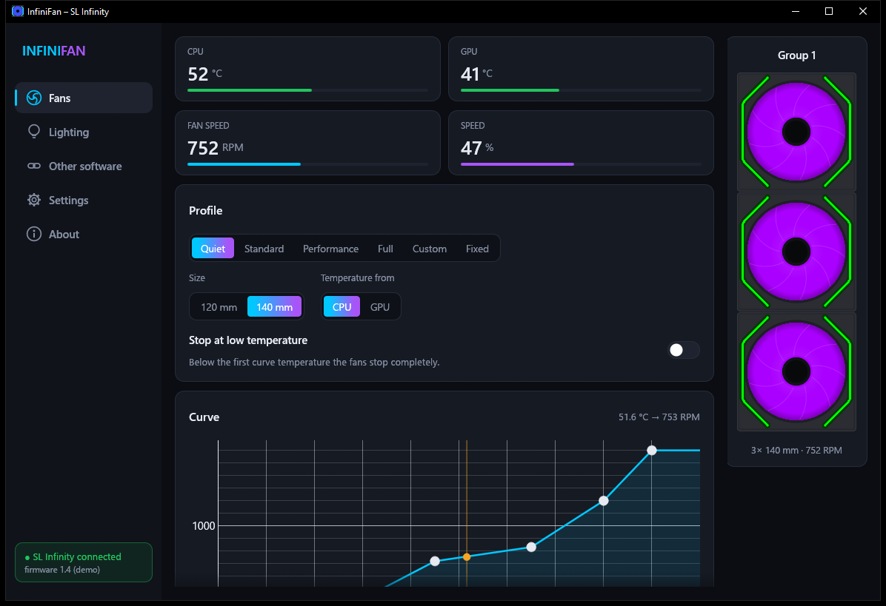
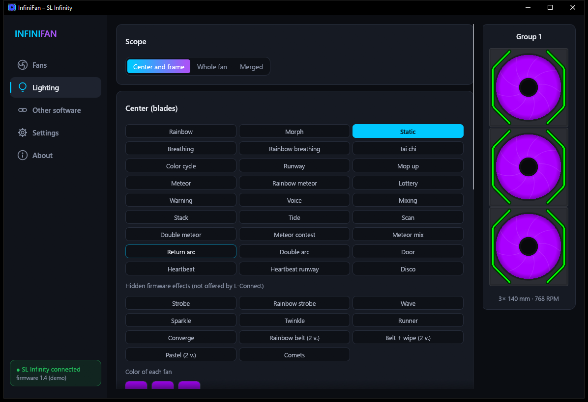

# InfiniFan

[](https://github.com/Krejza9/infinifan/actions/workflows/build.yml)

A small, fast replacement for **Lian Li L-Connect 3** for the **SL Infinity** fan controller, written in Rust.
It controls fan speed by CPU or GPU temperature, sets the lighting effects and can hand control over to the motherboard or another RGB program.
Control runs as a single small background process. The window only opens for settings and exits completely when closed.



## Why

L-Connect 3 consists of two always-running .NET Framework services and a window with an embedded Chromium browser.
InfiniFan does the same job with one native program: no services, no .NET, no browser.

| | Memory (RAM) | CPU |
|---|---|---|
| Background control (always running) | ~10 MB | ~0 % |
| Window with live preview (only while open) | ~73 MB | ~2 % of one core |

Measured on Windows 10 with a Ryzen 9 7950X3D and an RTX 4080, with 3 × SL Infinity 140 mm fans.

## Features

### Fans
- Speed curves by CPU or GPU temperature.
- The L-Connect presets (Quiet, Standard, Performance, Full), plus a custom curve and fixed speed.
- Stop the fans at low temperature.
- 120 or 140 mm fan size.
- Fan power is computed exactly like L-Connect 3, including its rounding.
- Curve points are kept in order and the speed never falls as the temperature rises.

### Lighting
- All L-Connect effects: separately for the center and the frame, for the whole fan, and merged effects across all groups.
- 11 extra **hidden firmware effects** that L-Connect doesn't offer.
- Changes are sent to the fans only after **Save**; until then the preview shows the draft.
- **Accurate preview:** LED colors come from an effect model written from observing what the fans actually show. Nearly every effect matches frame by frame.
- Color picker with a **My colors** palette.



### Other software
- **Motherboard sync:** fan speed (motherboard PWM) and lighting (motherboard ARGB).
- A switch that hands the lighting over to other programs such as **SignalRGB** or **OpenRGB**, like the original.

### System
- **CPU temperature** through the [PawnIO](https://pawnio.eu) driver (AMD Family 17h and newer). The program offers to run the official signed installer and checks its signature first.
- **GPU temperature** from the Windows graphics kernel (D3DKMT), the same source Task Manager uses. No extra driver or library.
- **Autostart** at sign-in through Task Scheduler (with administrator rights, needed for the CPU temperature).
- Tray icon, single instance.
- The controller is set up again after resume from sleep.
- On first start the program **imports the settings** from L-Connect 3 if it finds them.

### Languages
- English (default) and Czech. Switch in Settings; the change applies immediately.
- Translations are plain files in the `locales` folder next to `infinifan.exe` (`<code>.yml`, [rust-i18n](https://github.com/longbridge/rust-i18n)); the program loads them at startup. English and Czech are also built into the exe as a fallback.
- **New language without rebuilding:** copy `locales\en.yml` to a new code (e.g. `de.yml`), translate the values and restart the program. The language appears in the menu and missing texts fall back to English. Existing texts can be fixed the same way by editing the file.
- To add a language to the source, add a file to `locales/`. The `locales_have_same_keys` test makes sure no text is missing.

## Supported hardware

| | |
|---|---|
| Controller | Lian Li **SL Infinity**, USB `0CF2:A102`, firmware 1.4 |
| System | Windows 10 / 11, x64 |
| CPU temperature | AMD Ryzen (Family 17h+) via PawnIO; without PawnIO the curve follows the GPU |

Other Lian Li controllers (SL V2, TL, UNI HUB AL…) are not supported yet.

> **Before starting InfiniFan, stop and disable the L-Connect 3 service.** Two programs can't control the controller at the same time.

## Installation and running

1. Download the latest `InfiniFan-*.zip` from [Releases](https://github.com/Krejza9/infinifan/releases) and unpack it into any folder (it already contains `drivers\PawnIO_setup.exe`). It's portable: no installation, everything it needs sits next to it.
2. A newer PawnIO installer can be dropped into `drivers\` from [PawnIO.Setup releases](https://github.com/namazso/PawnIO.Setup/releases); it is only needed for the CPU temperature.
3. Run `infinifan.exe`. Background control starts and the window opens.

If the program's folder isn't writable (for example under `C:\Program Files`), settings and logs go to `%APPDATA%\InfiniFan` instead.
Autostart remembers where the exe is; after moving it, turn **Start after sign-in** off and on again.

| Command | What it does |
|---|---|
| `infinifan.exe` | Background control + window |
| `infinifan.exe --background` | Control only, with a tray icon (used by autostart) |
| `infinifan.exe --gui` | Window only, connects to the running control |
| `infinifan.exe --demo` | Preview without a controller (sends nothing to the device) |

Closing the window frees the graphics; control keeps running. To stop it completely use the tray icon → **Quit**.

### Files next to the program

```
infinifan.exe
config\infinifan.json      settings (saved automatically)
logs\infinifan.log         control log (infinifan.1.log = previous run)
logs\infinifan-gui.log     window log
drivers\PawnIO_setup.exe   optional installer of the CPU temperature driver
locales\<code>.yml         translations (loaded at startup, editable)
```

## Building from source

You need [Rust](https://rustup.rs) (stable, edition 2024) and the MSVC Build Tools with the Windows SDK.

```bash
cargo build --release
```

The result is `target/release/infinifan.exe`. GitHub Actions (`.github/workflows/build.yml`) runs the tests and builds on every push; pushing a `v*` tag publishes a release with the zip. The icon is embedded at build time (`build.rs`).

Tests:

```bash
cargo test --release
```

The tests check the curves against the original's calculation, the command plan for the controller, the effect model and the completeness of the translations. They compare the GPU temperature with `nvidia-smi` when it is available.

## Architecture

```
infinifan.exe --background            infinifan.exe --gui
┌───────────────────────────┐           ┌───────────────────────────┐
│ worker: curves, effects,  │  pipes    │ egui window               │
│ temperatures, USB HID     │◄─────────►│ preview (effect model)    │
│ tray icon                 │ \\.\pipe\ │                           │
└────────────┬──────────────┘           └───────────────────────────┘
             │ HID (report 0xE0)
        SL Infinity
```

| File | Contents |
|---|---|
| `src/device.rs` | SL Infinity protocol (HID feature/output reports) |
| `src/curve.rs` | Curves and fan power, computed like L-Connect 3 |
| `src/effects.rs` | Effect table and the command plan for the ports |
| `src/fxsim/` | Effect model for the accurate preview (from observed behaviour); each effect has its own file in `src/fxsim/effects/` |
| `src/worker.rs` | Control loop (1 s), sync, resume from sleep |
| `src/background.rs`, `src/ipc.rs` | Background process, tray icon, named pipes |
| `src/app.rs`, `src/preview.rs`, `src/widgets.rs` | Window (egui) and the fan preview |
| `src/sensors.rs`, `src/pawnio_setup.rs` | CPU (PawnIO) and GPU (D3DKMT) temperatures |
| `src/lang.rs`, `locales/` | Translations |

The pipes are accessible to local users only and reject remote connections.

## Safety

- **Settings in RAM only:** according to an analysis of firmware 1.4, all settings live in the controller's RAM and no USB command writes to flash. After a power cycle the controller returns to its defaults.
- **PawnIO** is a signed kernel driver. The program never installs it silently: it asks, runs the official installer and checks the author's signature (`namazso.eu`) first.
- **No internet:** the program doesn't connect to the internet and sends no data. The only network call is to SignalRGB on `127.0.0.1` when you hand the lighting over to it.

## Credits and third-party licenses

- [PawnIO](https://github.com/namazso/PawnIO) and [PawnIO.Modules](https://github.com/namazso/PawnIO.Modules) by namazso. The `AMDFamily17.bin` module is embedded in the program; its license is in `assets/pawnio/COPYING`. The official `PawnIO_setup.exe` (used by the signature check test) is GPL-2.0, see `assets/pawnio/PawnIO_setup-LICENSE.txt`.
- [egui / eframe](https://github.com/emilk/egui), [hidapi](https://github.com/ruabmbua/hidapi-rs), [tray-icon](https://github.com/tauri-apps/tray-icon), [windows-rs](https://github.com/microsoft/windows-rs), [rust-i18n](https://github.com/longbridge/rust-i18n).
- [Lucide](https://lucide.dev) icons (ISC license, see `assets/lucide/LICENSE`). The bundled font holds only the icons the program uses; `tools/lucide_subset.py` regenerates it and `src/icons.rs`.

L-Connect, SL Infinity and Lian Li are trademarks of Lian Li Industrial Co., Ltd.
This project is not affiliated with or endorsed by Lian Li. Use at your own risk.

## License

[MIT](LICENSE) © Krejza9. Bundled third-party files keep their own licenses (see above).
